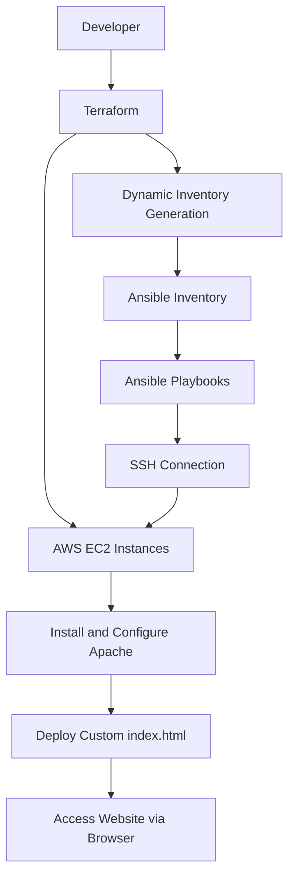

# Terraform + Ansible EC2 Automation

## Overview

This project demonstrates **Infrastructure as Code (IaC)** and **Configuration Management** by combining Terraform and Ansible to automate infrastructure provisioning and server configuration on AWS.

The project automates the following tasks:

- **Terraform:** Provisions AWS EC2 instances.
- **Dynamic Inventory:** Generates Ansible inventory automatically using Terraform outputs.
- **Ansible:** Connects to EC2 instances over SSH and configures the servers.
- **Apache:** Installs and configures the Apache web server.
- **HTML:** Deploys a custom webpage to the Apache web server.

## Architecture

The following diagram illustrates the infrastructure provisioning and configuration workflow.



## Technologies Used

| Technology | Purpose |
|---|---|
| AWS EC2 | Virtual server hosting |
| Terraform | Infrastructure provisioning |
| Ansible | Configuration management |
| Ubuntu Linux | Operating system |
| SSH | Secure remote connectivity |
| PowerShell | Local command-line interface |
| Git & GitHub | Version control and source code hosting |
| HTML | Custom webpage development |
| Apache | Web server |

## Project Structure

```text
terraform-ansible-ec2-automation/
│
├── inventories/
│   └── dev/
│       └── hosts.ini
│
├── playbooks/
│   ├── files/
│   │   └── index.html
│   └── install-apache.yml
│
├── terraform/
│   ├── ec2.tf
│   ├── providers.tf
│   ├── variables.tf
│   ├── outputs.tf
│   ├── generate-inventory.tf
│   └── templates/
│       └── inventory.tpl
│
├── .gitignore
└── README.md
```

## Workflow

1. Configure AWS credentials.
2. Initialize Terraform.
3. Validate Terraform configuration.
4. Provision EC2 instances on AWS.
5. Generate Ansible inventory dynamically using Terraform outputs.
6. Establish SSH connectivity between the Ansible control node and target EC2 instances.
7. Execute Ansible playbooks.
8. Install and configure Apache.
9. Deploy the custom HTML webpage.
10. Access the deployed website using the EC2 public IP address.

## Prerequisites

Before running this project, ensure you have:

- An AWS account.
- AWS CLI installed and configured.
- Terraform installed.
- Ansible installed on the control node.
- SSH key pair for EC2 connectivity.
- Appropriate AWS IAM permissions.
- Required security group rules for SSH and HTTP access.

## Deployment Instructions

### 1. Configure AWS credentials

Configure your AWS CLI credentials using:

```bash
aws configure
```

Alternatively, use an appropriately configured IAM role.

### 2. Initialize Terraform

Navigate to the Terraform directory:

```bash
cd terraform
terraform init
```

### 3. Validate Terraform configuration

```bash
terraform validate
```

### 4. Preview infrastructure changes

```bash
terraform plan
```

### 5. Provision EC2 infrastructure

```bash
terraform apply
```

Review the execution plan and confirm the operation.

### 6. Verify Ansible connectivity

From the directory containing your inventory, run:

```bash
ansible all -i inventories/dev/hosts.ini -m ping
```

### 7. Execute the Ansible playbook

```bash
ansible-playbook -i inventories/dev/hosts.ini playbooks/install-apache.yml
```

Adjust the inventory path if you execute the command from a different directory or use another inventory location.

## Verification

Verify that Apache is running on the target EC2 instance:

```bash
sudo systemctl status apache2
```

Test the deployed webpage:

```bash
curl http://<EC2-PUBLIC-IP>
```

You can also open the EC2 public IP address in your web browser to view the deployed webpage.

## Security Considerations

- Never commit private SSH keys to GitHub.
- Never commit AWS credentials.
- Keep Terraform state files and sensitive backups out of public repositories.
- Use IAM roles and least-privilege permissions.
- Restrict SSH access to trusted IP addresses.
- Allow HTTP access only as required.
- Avoid exposing sensitive infrastructure information.

## Cleanup

To remove the infrastructure created by Terraform, navigate to the Terraform directory and run:

```bash
terraform destroy
```

Review the proposed changes before confirming.

## Author

Created as a hands-on DevOps and Infrastructure as Code learning project.

**Focus Areas:** AWS | Terraform | Ansible | Linux | Automation 